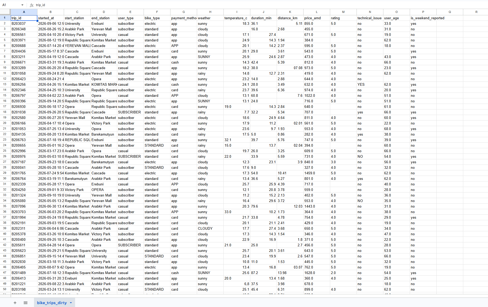
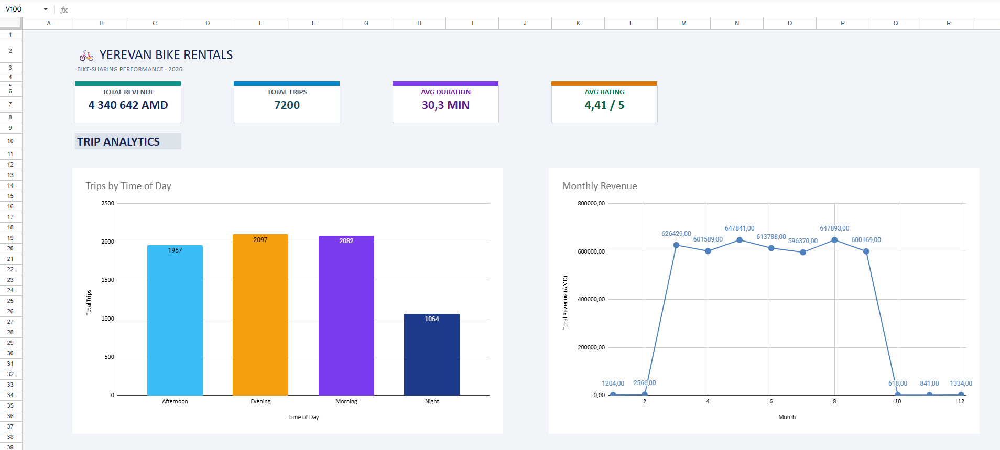
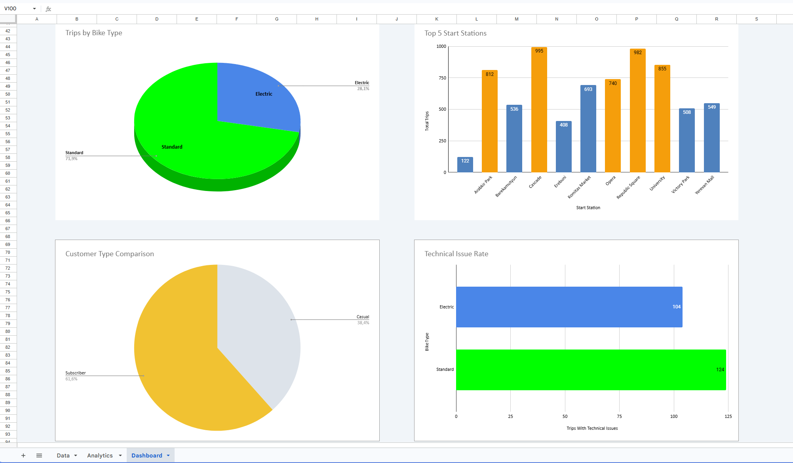

# 🚲 Bike Trips Analytics Dashboard

An end-to-end bike-sharing analytics project focused on customer behavior, ride patterns, revenue performance, and operational efficiency.

The project demonstrates how raw rental data can be transformed into a structured dataset, analyzed using spreadsheet tools, and presented through an interactive-style dashboard with actionable business recommendations.

## 📌 Project Overview

The goal of this project is to explore bike-sharing operations and identify patterns that can help a business understand its customers, monitor revenue, improve bike availability, and investigate operational issues.

The project covers the full analytical workflow:

- Reviewing the original dataset and identifying data quality issues.
- Cleaning and standardizing the data.
- Organizing the cleaned data into a structured table.
- Building pivot tables to analyze key business metrics.
- Creating a dashboard with KPIs and visualizations.
- Summarizing key findings and proposing business recommendations.

> **Note:** The dataset is synthetic and is used for educational and portfolio purposes.

## 🛠️ Tools & Technologies

- **Microsoft Excel / Google Sheets** — data organization, pivot tables, formatting, and dashboard development.
- **Pivot Tables** — aggregation and comparison of operational and customer metrics.
- **Data Visualization** — charts for demand patterns, revenue, bike preferences, station activity, and technical issues.
- **Data Cleaning** — handling missing values, inconsistent labels, data types, and suspicious records.
- **Business Analysis** — translating analytical observations into recommendations.

## 🔎 Project Workflow

### 1. Original Dataset

The original dataset contained inconsistent values, missing information, formatting issues, and records requiring validation.

The first step was to review the available columns and identify data quality problems before performing the analysis.

### 2. Data Cleaning and Preparation

The dataset was cleaned and standardized to improve consistency and make the data suitable for analysis.

Key preparation steps included:

- Standardizing column names and category labels.
- Converting dates, numerical values, and other fields into appropriate formats.
- Identifying missing and invalid values.
- Reviewing negative trip durations, distances, prices, and suspicious ratings or ages.
- Creating analytical fields such as month, hour, weekday, time of day, weekend indicator, speed, and age group.
- Validating reported weekend values against the actual trip date.

Potential outliers were not automatically removed when there was insufficient evidence that the records were invalid.

### 3. Exploratory Analysis with Pivot Tables

Pivot tables were used to summarize the data and compare key metrics across different categories.

The analysis covered:

1. Customer type analysis.
2. Bike type analysis.
3. Time-of-day analysis.
4. Start station analysis.
5. Monthly revenue analysis.
6. Weekend versus weekday analysis.
7. Weather analysis.
8. Rating analysis.
9. Technical issue analysis.
10. Age group analysis.

These summaries provide a structured view of customer behavior, demand, revenue, and operational performance.

### 4. Dashboard Development

The final dashboard brings the most important metrics and visualizations together in one place.

It includes KPI cards, charts, key findings, and business recommendations to make the results easier to understand.

## 📊 Key Performance Indicators

| Metric | Result |
|---|---:|
| Total Trips | 7,200 |
| Total Revenue | 4,340,642 AMD |
| Average Trip Duration | 30.3 minutes |
| Average Rating | 4.41 / 5 |

## 💡 Key Findings

### 1. Customer Behavior

Casual users have a longer average trip duration than subscribers:

- Casual users: **36.42 minutes**
- Subscribers: **26.43 minutes**

This difference may reflect different usage patterns and could be explored when designing customer retention or subscription campaigns.

### 2. Bike Type Preference

- Standard bikes account for **5,175 trips (71.9%)**.
- Electric bikes account for **2,025 trips (28.1%)**.

Standard bikes are used substantially more often in this dataset. Electric bikes have a higher average trip distance: approximately **4.21 km**, compared with **3.13 km** for standard bikes.

### 3. Demand Patterns

Trip volume is highest during the evening and morning periods:

- Evening: **2,097 trips**
- Morning: **2,082 trips**
- Afternoon: **1,957 trips**
- Night: **1,064 trips**

This pattern can help inform bike availability, redistribution, and maintenance planning.

### 4. Revenue Performance

Within the main March–September analysis period:

- July recorded the highest monthly revenue at **647,841 AMD**.
- March recorded the lowest monthly revenue at **626,429 AMD**.

The dataset also contains a small number of trips outside this main period. These records were retained, so the full dataset totals should not be interpreted as covering March–September only.

### 5. Technical Issues

Reported technical issue rates differ by bike type:

- Electric bikes: **104 issue reports across 2,025 trips (5.14%)**.
- Standard bikes: **124 issue reports across 5,175 trips (2.40%)**.

Although standard bikes have more issue reports in absolute numbers, electric bikes have the higher issue rate. This warrants further investigation into maintenance records and bike condition.

## 🚀 Business Recommendations

### 1. Encourage Electric Bike Adoption

Offer a limited electric-bike trial to customers who usually rent standard bikes. Measure trial conversion, repeat usage, and customer feedback before expanding the offer.

### 2. Review Electric Bike Maintenance

Investigate the higher reported technical issue rate for electric bikes. Review maintenance records, categorize issue types, and monitor issue rates over time.

### 3. Encourage Subscription Conversions

Show casual users the potential savings of a subscription and test targeted introductory offers for customers with repeated rentals.

### 4. Optimize Bike Availability

Use morning and evening demand patterns to plan bike redistribution and maintenance schedules. Validate these patterns over time before changing staffing or fleet allocation.

### 5. Improve Trip-End Management

If a bike remains stationary for more than 10 minutes, consider sending an in-app notification asking the customer whether they intend to end the trip. The system should not automatically end the rental based only on inactivity.

### 6. Improve Data Quality

Add validation rules for age, duration, distance, and ratings. Investigate missing and suspicious values at the point of entry to reduce incomplete or inconsistent records.

### 7. Test Weather-Based Promotions

Evaluate targeted promotions during rainy or less popular periods. Measure whether they increase rentals and revenue before adopting them as a permanent pricing strategy.

### 8. Monitor Business Performance

Track trip volume, revenue, average duration, customer type, and technical issue rates regularly. Use consistent definitions and compare rates rather than raw counts when group sizes differ.

## ⚠️ Limitations

- The dataset is synthetic and does not represent verified real-world company performance.
- Some fields contain missing or suspicious values that cannot be reliably reconstructed.
- The rating validity range of 1–5 was used as an analytical assumption.
- Trips outside the main March–September period were retained in the full dataset.
- Observed differences and associations do not establish causation.
- Business recommendations are proposals to test, not proven outcomes.

## 📁 Files

- **`bike_trips_dirty.xlsx`** — original dataset for comparison.
- **`bike_trips_analytics_dashboard.xlsx`** — prepared dataset, pivot-table analysis, and dashboard.

Download the Excel workbook to explore the `Data`, `Analytics`, and `Dashboard` sheets.

## 🎯 Conclusion

This project demonstrates a complete spreadsheet-based analytics workflow, from reviewing raw data and addressing data quality issues to building pivot-table summaries, communicating findings, and proposing practical business actions.

The final dashboard provides a concise overview of customer behavior, bike preferences, demand patterns, revenue, and operational issues.

---

*Created as a Data Analyst portfolio project.*
